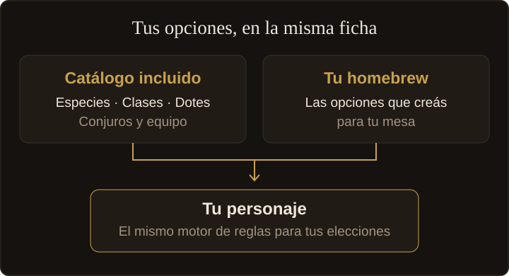

  

  <strong>Tu personaje y tu mesa, en el mismo lugar.</strong> 
  Creá personajes, dirigí campañas y prepará tu próxima sesión de D&D 5e con las reglas de 2024, desde el navegador.

  <a href="https://app.milantus.com.ar/"><strong>Abrir Milantus →</strong></a> ·
  <a href="docs/README.md">Documentación</a> ·
  <a href="docs/operaciones/despliegue.md">Autoalojamiento</a> ·
  <a href="https://github.com/gasToledo/Milantus/issues">Reportar un problema</a>

  
  &nbsp; · &nbsp; Español e inglés &nbsp; · &nbsp; Web &nbsp; · &nbsp; Autoalojado

*Capturas de la aplicación con datos de ejemplo. Abrí cada imagen para verla en detalle.*

## Un personaje que te acompaña de nivel en nivel

Elegí quién querés llevar a la mesa. Milantus calcula modificadores,
competencias, armadura, ataques y magia a partir de tus elecciones.

- **Creación guiada y multiclase.** Elegí especie, trasfondo, clase, dotes y
  equipo. Al subir de nivel, revisá los cambios antes de confirmar.
- **La ficha durante la partida.** Llevá puntos de golpe, condiciones,
  concentración, conjuros, recursos y descansos. Consultá tu inventario y
  anotá lo que pasó en el diario.
- **También en papel.** Imprimí la ficha o guardala como PDF para llevarla
  a la mesa.

## Prepará la sesión. Dirigí tu mesa.

Pasá al Modo DM con la misma cuenta. Reuní la preparación y lo que sucede
durante la partida en tus campañas.

- **Campañas y capítulos.** Organizá objetivos, notas y el cuaderno de la
  mesa. Anunciá nivel, oro y objetos al cerrar un capítulo.
- **Encuentros y PNJ.** Consultá el bestiario, prepará los participantes y
  llevá iniciativa, rondas y puntos de golpe. Ambientá cada campaña con
  escenas de música.
- **La mesa conectada.** Los jugadores comparten sus personajes mediante un
  código temporal. Vos consultás sus fichas; cada jugador conserva el
  control de la suya.

## Consultá el Códice. Creá tus propias opciones.

Buscá lo que necesitás para jugar o preparar la próxima sesión, sin tener
que crear un personaje para leer una opción.

- **Reglas a mano.** Consultá especies, clases, subclases, trasfondos, dotes,
  conjuros y equipo desde el Códice.
- **Primeros pasos.** Un glosario y guías para entender la partida, crear tu
  primer personaje y aprender a leer la ficha.
- **Homebrew integrado.** Creá equipo, especies, trasfondos, dotes, conjuros y
  criaturas. Tus opciones usan el mismo motor de efectos que el catálogo
  incluido y aparecen en los asistentes y las fichas.

<strong>Respaldos y herramientas opcionales</strong>

- **Exportación e importación.** Trasladá personajes o guardá un respaldo
  con fichas, retratos, homebrew y preferencias, sin credenciales.
- **Retratos.** Cargá una imagen o generala con los proveedores de IA
  configurados en tu servidor.
- **Conexión con Claude.** El [conector MCP](docs/arquitectura/mcp.md) permite
  trabajar con tus personajes, campañas y contenido desde tu cuenta, con
  permisos de lectura y escritura.

  <a href="https://app.milantus.com.ar/"><strong>Abrir Milantus →</strong></a>

## Estado del proyecto y desarrollo

Milantus se desarrolla para la web y ofrece la interfaz en español e inglés.
El cliente Flutter convive con un cliente React en `/v2`, en migración y
habilitado por cuenta. El [estado de la migración](docs/arquitectura/migracion-react.md)
detalla qué está disponible en el cliente nuevo.

| Paquete | Responsabilidad |
| --- | --- |
| [`dnd_app`](packages/dnd_app) | Cliente Flutter Web. |
| [`dnd_web`](packages/dnd_web) | Cliente React, TypeScript y Vite bajo `/v2`. |
| [`dnd_engine`](packages/dnd_engine) | Motor de reglas en Dart y catálogo dirigido por datos. |
| [`dnd_server`](packages/dnd_server) | API con Shelf y PostgreSQL: sesiones, persistencia y permisos. |

Los dos clientes usan el mismo motor de reglas; React lo ejecuta compilado
a JavaScript.

- [Documentación](docs/README.md): arquitectura, contenido y guías de desarrollo.
- [Autoalojamiento](docs/operaciones/despliegue.md): instalación y operación del stack.
- [Convenciones de desarrollo](CLAUDE.md): requisitos, comandos y verificaciones.
- [Novedades](CHANGELOG.md): cambios visibles de cada versión.
- [Problemas y propuestas](https://github.com/gasToledo/Milantus/issues): errores e ideas para mejorar la aplicación.

## Reglas y atribuciones

Esta obra incluye material procedente del documento de referencia del sistema
5.2.1 ("SRD 5.2.1") de Wizards of the Coast LLC, disponible en
[D&D Beyond](https://www.dndbeyond.com/srd). La licencia sobre el SRD 5.2.1 se concede de
acuerdo con la licencia internacional de atribución/reconocimiento 4.0 de
Creative Commons, disponible en
[su texto legal](https://creativecommons.org/licenses/by/4.0/legalcode).

El catálogo incluye además opciones del PHB 2024 y de *Forge of the Artificer*.
El contenido que no forma parte del SRD se identifica por separado y no se
presenta como contenido cubierto por esa licencia Creative Commons.
