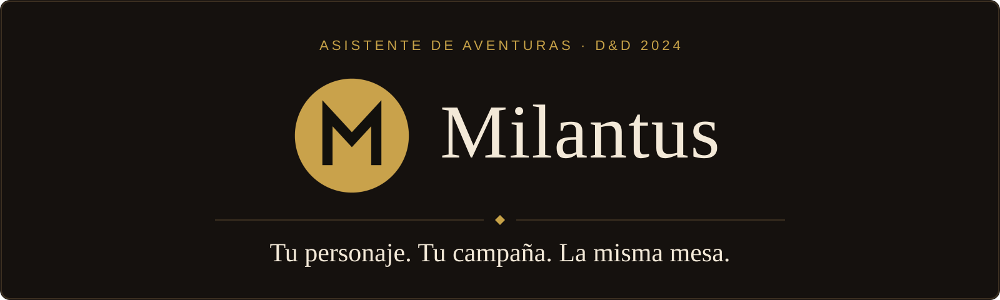
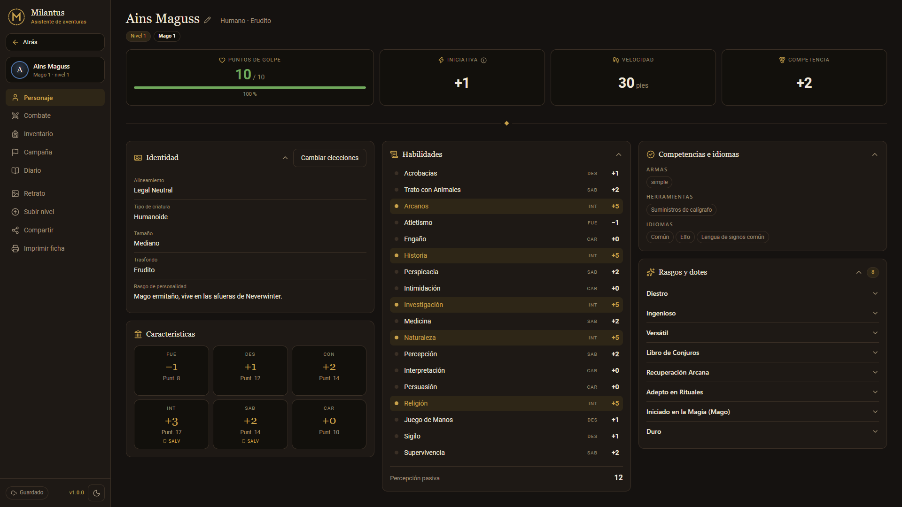
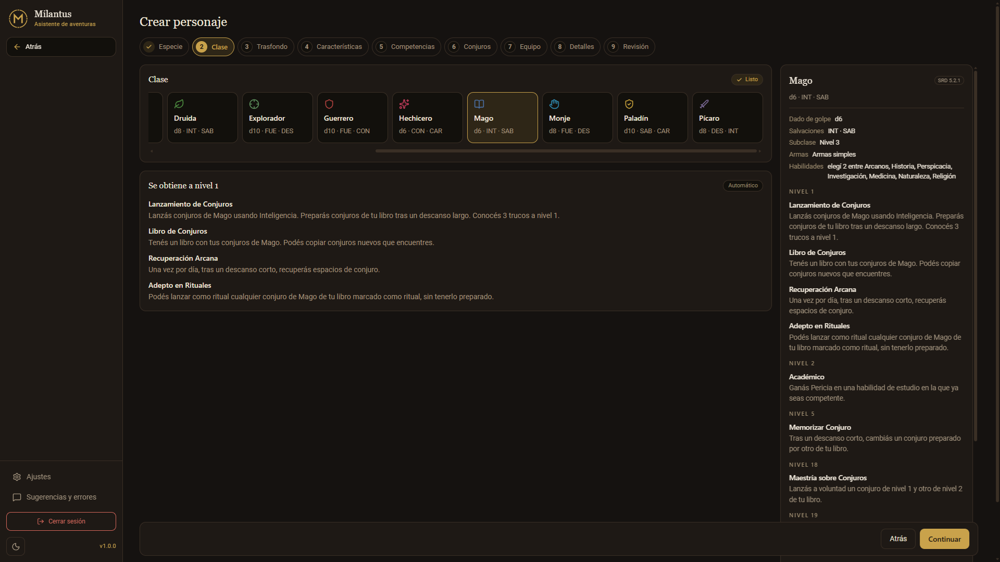
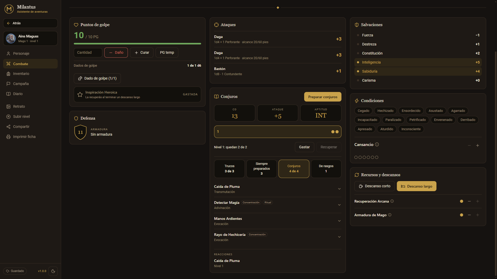
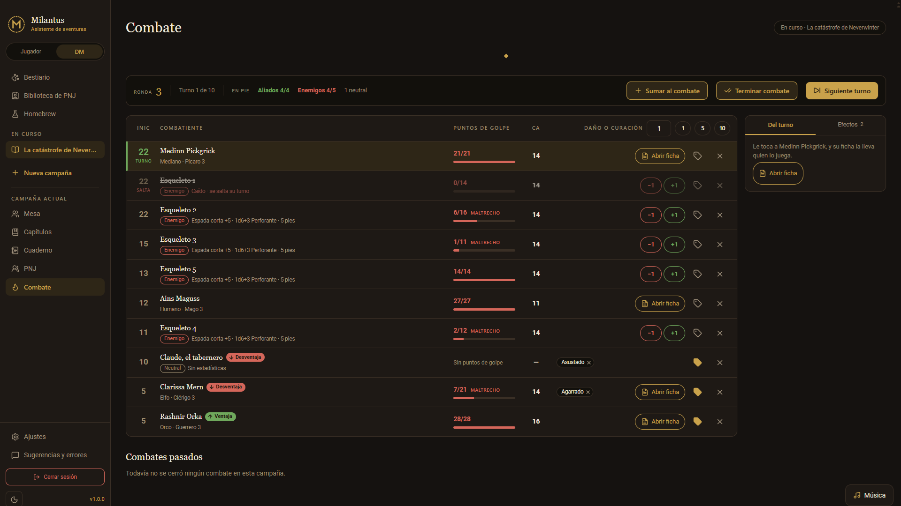
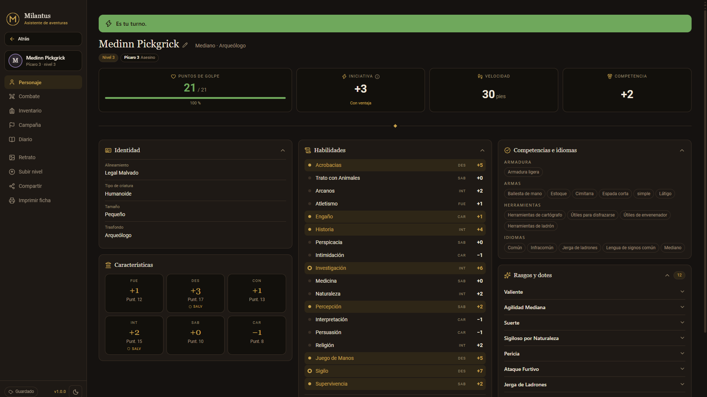
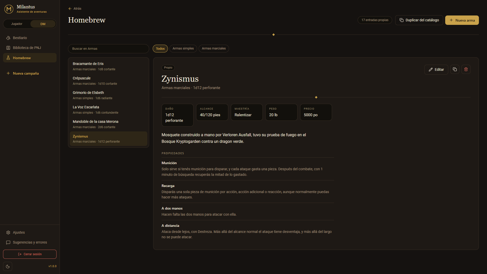

  

  Creá tu personaje, prepará la aventura y llevá la partida de <strong>D&D 5e con las reglas de 2024</strong> desde el navegador.

  <a href="https://app.milantus.com.ar/"><strong>Abrir Milantus →</strong></a> ·
  <a href="docs/README.md">Documentación</a> ·
  <a href="https://github.com/gasToledo/Milantus/issues">Sugerencias y errores</a>

  
  &nbsp; · &nbsp; Español e inglés &nbsp; · &nbsp; Web &nbsp; · &nbsp; Autoalojamiento

*Capturas de la interfaz web v2 con personajes y una campaña de ejemplo. Abrí cada imagen para verla en detalle.*

## Creá tu personaje

Elegí especie, clase y trasfondo. El asistente te acompaña por las características,
competencias, conjuros y equipo, con el detalle de cada opción a la vista.
Milantus calcula la ficha a partir de tus elecciones.

- **De la idea a la ficha.** Revisá lo que elegiste antes de crear el personaje.
- **Un personaje que crece.** Subí de nivel, elegí subclase y sumá otra clase
  cuando tu personaje tome ese camino.
- **Cambios a la vista.** Consultá los nuevos rasgos, recursos y elecciones
  antes de confirmar una subida.

## Jugá con todo a mano

Durante la partida, la ficha reúne lo que tu personaje necesita para actuar.
Sus ataques, conjuros y recursos quedan junto a los controles de uso diario.

- **Combate y descansos.** Llevá puntos de golpe, condiciones, concentración,
  espacios de conjuro y recursos. Resolvé descansos desde la misma ficha.
- **Inventario.** Administrá equipo y monedas, comprá o vendé objetos y elegí
  qué llevás equipado.
- **Historia y retrato.** Anotá el trasfondo y lo que pasó en el Diario, agregá
  imágenes y dale un rostro a tu personaje.

También podés imprimir la ficha o guardarla como PDF para llevarla a la mesa.

## Dirigí tu aventura

Con la misma cuenta, pasá al Modo DM y reuní la preparación de tus campañas.
Los jugadores vinculan sus personajes mediante un código temporal; vos podés
consultar sus fichas y cada persona conserva el control de su personaje.

- **Campañas y capítulos.** Organizá objetivos y recompensas. Usá el Cuaderno
  para guardar notas privadas o compartir con la mesa lo que quieras revelar.
- **PNJ con historia.** Armá tu biblioteca con retratos, trasfondos y notas.
  Elegí entre un PNJ sin estadísticas, un bloque de criatura o una ficha completa.
- **Encuentros y ambiente.** Prepará aliados, enemigos y neutrales. Llevá
  iniciativa, rondas, puntos de golpe y condiciones, y guardá escenas de música
  de YouTube o YouTube Music para reproducirlas desde el Modo DM.

### Una partida. Dos perspectivas.

El DM avanza el combate y la ficha del personaje avisa cuando llega su turno.
En esta ronda le toca a Medinn Pickgrick: el mismo momento, visto desde ambos
lados de la mesa.

*Desde el Modo DM: el orden del combate y el estado de sus participantes.*

*Desde la ficha del jugador: el aviso de turno junto a su personaje.*

## Dale forma a tu mundo

Consultá el Códice y el Bestiario mientras preparás la sesión, y agregá tus
propias opciones con homebrew. Un arma puede tener nombre, historia y reglas
propias, como Zynismus, el mosquete de Verloren Ausfall.

- **Homebrew integrado.** Creá equipo, objetos mágicos, especies, trasfondos,
  dotes, conjuros y criaturas. Tus opciones aparecen en los asistentes y las
  fichas junto al catálogo incluido.
- **Códice y Bestiario.** Buscá reglas, opciones de personaje y criaturas
  desde sus catálogos.
- **Primeros pasos en D&D.** Consultá el glosario y las guías para entender
  la partida, crear tu primer personaje y aprender a leer la ficha.

**[Recorré Milantus v2 en imágenes →](docs/recorrido-visual.md)**  
Creación, subida de nivel, inventario, Diario, campañas, PNJ, combate, música
y catálogos, organizados por recorrido.

<strong>Respaldos y herramientas opcionales</strong>

- **Exportación e importación.** Trasladá personajes o guardá un respaldo
  con fichas, retratos, homebrew y preferencias, sin credenciales.
- **Retratos con IA.** Además de subir una imagen, podés generar un retrato
  cuando el servidor tiene un proveedor configurado.
- **Conexión con Claude.** El [conector MCP](docs/arquitectura/mcp.md) permite
  trabajar con personajes, campañas y contenido desde tu cuenta, con permisos
  de lectura y escritura.

## Empezá a usar Milantus

1. **[Abrí la aplicación](https://app.milantus.com.ar/)** e iniciá sesión.
2. **Elegí por dónde empezar.** Creá un personaje o probá con uno de ejemplo.
   Para dirigir, pasá al Modo DM y creá tu primera campaña.
3. **Reuní a la mesa.** Desde la ficha, usá «Compartir» para generar un código.
   El DM lo agrega a su campaña desde «Sumar personaje».

> Milantus abre la interfaz v2, la de las capturas de este README, en todas las
> cuentas. Mientras dura la migración, la versión anterior sigue disponible desde
> Ajustes, con «Usar la versión anterior». Consultá el [estado de la migración](docs/arquitectura/migracion-react.md).

  <a href="https://app.milantus.com.ar/"><strong>Abrir Milantus →</strong></a>

## Desarrollo y autoalojamiento

La interfaz se ofrece en español e inglés. El cliente React de v2 convive con
Flutter durante la migración; ambos usan el mismo motor de reglas en Dart,
compilado a JavaScript para React.

| Paquete | Responsabilidad |
| --- | --- |
| [`dnd_web`](packages/dnd_web) | Cliente React, TypeScript y Vite, servido bajo `/v2`. |
| [`dnd_engine`](packages/dnd_engine) | Motor de reglas y catálogo dirigido por datos. |
| [`dnd_server`](packages/dnd_server) | API con Shelf y PostgreSQL: sesiones, persistencia y permisos. |
| [`dnd_app`](packages/dnd_app) | Cliente Flutter Web, disponible durante la migración. |

- **[Documentación](docs/README.md):** arquitectura, contenido y guías de desarrollo.
- **[Autoalojamiento](docs/operaciones/despliegue.md):** instalación y operación del stack.
- **[Convenciones de desarrollo](CLAUDE.md):** requisitos, comandos y verificaciones.
- **[Novedades](CHANGELOG.md):** cambios visibles de cada versión.

## Cómo colaborar

Si encontrás un problema o tenés una propuesta, abrí un
[issue](https://github.com/gasToledo/Milantus/issues). Para reportar un error,
contá qué estabas haciendo, qué esperabas y qué ocurrió; una captura ayuda
a ubicarlo. Para contribuir con código, empezá por las
[convenciones del repositorio](CLAUDE.md).

## Reglas y atribuciones

Esta obra incluye material procedente del documento de referencia del sistema
5.2.1 ("SRD 5.2.1") de Wizards of the Coast LLC, disponible en
[D&D Beyond](https://www.dndbeyond.com/srd). La licencia sobre el SRD 5.2.1 se concede de
acuerdo con la licencia internacional de atribución/reconocimiento 4.0 de
Creative Commons, disponible en
[su texto legal](https://creativecommons.org/licenses/by/4.0/legalcode).

El catálogo incluye además opciones del PHB 2024 y de *Forge of the Artificer*.
El contenido que no forma parte del SRD se identifica por separado y no se
presenta como contenido cubierto por esa licencia Creative Commons.
